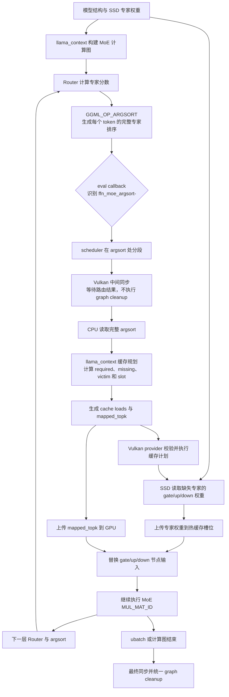

# Commit 24c39583：MoE 专家缓存回调与调度上移

## 1. Commit 概览

Commit `24c39583d1668ba01c8cb657f27cdaa66ce4f485` 的提交说明是：

> 将 MoE 专家缓存逻辑从 Vulkan 后端转到上层执行，支持更多后端。

这次提交的实际范围是一个**阶段性架构改造**。它已经把“读取路由结果、计算缓存计划”的主要逻辑移动到了 `llama_context`，并为 scheduler 增加了适合计算图中间断点的同步语义；但是专家缓存张量、SSD 权重读取、GPU 上传以及 MoE 节点输入替换仍然由 Vulkan 实现。

因此，当前提交更准确的描述是：

```text
Vulkan 内部自行决定缓存
        ↓
llama_context 读取路由结果并决定缓存计划
        ↓
Vulkan 按计划执行设备侧缓存操作
```

它为后续支持 CUDA 或其他 backend 预留了执行边界，但本提交本身尚未实现真正的 backend 无关专家缓存。

提交作者为 Coffee，提交者为 bigA151，提交时间为 2026-08-06。提交共修改 8 个文件，新增约 933 行、删除约 265 行。

## 1.1 总体数据流

下面的流程图展示了一次 MoE 层从路由结果产生，到专家缓存计划执行，再到后续计算继续运行的完整数据流。图中左侧是模型和 SSD 数据来源，中间是 `llama_context` 与 scheduler 的控制流，右侧是 Vulkan 的设备侧执行流。



流程图中的关键边界是：`argsort` 仍由设备计算，`llama_context` 只读取其结果并制定计划；专家权重读取、GPU 上传和节点输入替换仍由 Vulkan 完成。每层 callback 使用中间同步，而完整 graph cleanup 延迟到 ubatch 或整张计算图结束时执行。

## 2. 背景：为什么需要上移缓存逻辑

MoE 模型不会在每一层都使用全部专家。路由器会为每个 token 计算专家分数，并选择 `n_expert_used` 个专家参与计算。SSD 专家缓存的基本思路是：

- 完整专家权重保存在 SSD 或 GGUF 文件中；
- GPU 显存中只保留每层的一部分“热专家”；
- 当路由结果需要未驻留的专家时，把该专家的 gate/up/down 权重从 SSD 读取到缓存槽位；
- 将原始专家编号转换为缓存槽位编号，再执行 `MUL_MAT_ID`。

旧实现把路由解释、缓存淘汰和 Vulkan 设备操作都放在 Vulkan 后端中。后端需要从计算图中的固定相对位置推断：

- 哪个节点是 `argsort`；
- 哪些节点是 gate、up、down；
- 当前节点对应哪一层；
- 哪些专家需要换入以及哪些专家可以淘汰。

这种实现有两个问题：

1. 缓存策略依赖具体计算图排列，节点融合、模型结构或调度方式变化后容易失效。
2. 缓存决策依赖 Vulkan 类型和 Vulkan 内部状态，其他 backend 无法复用同一套策略。

本提交先解决第一层问题：让模型语义相关的路由和缓存规划进入 `llama_context`，让 Vulkan 主要负责设备侧执行。

## 3. 文件改动总览

| 文件 | 作用 |
| --- | --- |
| `src/llama-context.cpp` | 注册专家缓存 provider，读取 `argsort`，规划缓存换入/淘汰，管理 eval callback 和诊断计时 |
| `src/llama-context.h` | 增加 callback、argsort 缓冲区、缓存状态和计时状态 |
| `src/llama-graph.cpp` | 为 MoE 的完整专家排序结果和 top-k 结果明确命名 |
| `ggml/include/ggml-vulkan.h` | 增加缓存计划结构、缓存准备回调和 Vulkan 应用缓存的 API |
| `ggml/src/ggml-backend-impl.h` | 为 backend 增加可选的中间同步接口 |
| `ggml/src/ggml-backend.cpp` | 在 scheduler 的中间依赖点使用中间同步，保留旧 backend 的兼容回退 |
| `ggml/src/ggml-vulkan/ggml-vulkan.cpp` | 执行缓存计划、维护热专家张量、上传 `mapped_topk`、替换节点输入以及记录耗时 |
| `SSD_EXPERT_CACHE_CALLBACK_STAGE.md` | 记录本阶段已完成内容、未完成内容和后续架构方向 |

## 4. 计算图命名改动

文件：`src/llama-graph.cpp`

MoE 路由调用 `ggml_argsort_top_k` 后会产生两类结果：

- `selected_experts->src[0]`：每个 token 的全部专家排序结果；
- `selected_experts`：从完整排序结果中取出的前 `n_expert_used` 个专家。

本提交继续使用 `ffn_moe_argsort-<layer>` 和 `ffn_moe_topk-<layer>` 这两个名字，但补充了明确注释，说明前者是完整排序结果，后者是 top-k 结果。

完整排序结果非常重要。缓存规划不仅要知道当前 token 使用的 top-k 专家，还要在缓存 miss 时从较低排名中寻找可淘汰的驻留专家。因此上层需要读取完整的 `argsort`，而不是只读取 top-k。

Vulkan 应用缓存计划时还通过以下名称定位本层的三个专家计算节点：

```text
ffn_moe_gate-<layer>
ffn_moe_up-<layer>
ffn_moe_down-<layer>
```

节点操作类型同时要求为 `GGML_OP_MUL_MAT_ID`。这比依赖节点数组中的固定偏移更稳定，但节点输入仍然是在执行期间由 Vulkan 修改，后文会说明这一点仍是未完成的架构工作。

## 5. 新的 callback 执行流程

### 5.1 callback 的两阶段语义

`llama_context` 新增：

```cpp
static bool eval_callback_trampoline(ggml_tensor * tensor, bool ask, void * user_data);
bool eval_callback(ggml_tensor * tensor, bool ask);
```

它通过 trampoline 接入 `ggml_backend_sched_set_eval_callback`，并同时承载两类 callback：

- 用户原有的 `cparams.cb_eval`；
- SSD 专家缓存使用的内部 callback。

当 scheduler 以 `ask = true` 询问某个节点是否需要单独处理时，内部 callback 会检查：

1. tensor 的操作是否为 `GGML_OP_ARGSORT`；
2. tensor 名称是否符合 `ffn_moe_argsort-<layer>`；
3. tensor 是否有有效数据；
4. 该 tensor 实际分配到的 backend 是否为 Vulkan。

如果满足条件，callback 返回 `true`，scheduler 就会把计算图切分到这个 `argsort` 节点。这样在 `argsort` 完成后，CPU 可以读取路由结果并规划缓存。

当 scheduler 以 `ask = false` 通知节点所在的分段已经完成时，callback 会：

1. 从 backend 读取完整 `argsort` 张量；
2. 校验 tensor 类型、形状和字节数；
3. 调用 `ggml_backend_vk_apply_ssd_expert_cache`；
4. 让 scheduler 继续执行后续节点。

用户 callback 的行为也被保留：在 `ask = true` 阶段返回 true 的用户节点会记录到 `eval_callback_user_requested` 集合中，后续只在对应节点完成时调用一次 `ask = false`。因此新增的 SSD callback 不会覆盖原有用户回调的完成通知。

### 5.2 一次 MoE 层的实际时序

```text
计算 gate/router 分数
        ↓
计算完整 argsort
        ↓
scheduler 在 argsort 处切分并提交前半段图
        ↓
Vulkan 中间同步：等待 GPU 完成，但不清理整张图的临时资源
        ↓
llama_context 从设备读取完整 argsort
        ↓
llama_context 计算缓存换入、淘汰和 mapped_topk
        ↓
Vulkan 读取缺失专家的 gate/up/down 权重并上传
        ↓
Vulkan 上传 mapped_topk，并替换本层 MoE 节点输入
        ↓
继续执行本层剩余节点
```

`eval_graph` 在 `graph_compute` 期间保存当前图指针，以便 callback 通过 Vulkan API 修改当前计算图；计算结束后立即清空。任何参数或数据校验失败都会设置 `ssd_expert_cache_failed`，即使 scheduler 本身返回成功，`graph_compute` 最终也会把状态改为失败。

## 6. 上层缓存规划算法

文件：`src/llama-context.cpp` 中的 `llama_vk_ssd_expert_prepare_cache`。

### 6.1 输入信息

规划函数通过 `ggml_vk_ssd_expert_cache_plan` 接收以下数据：

```cpp
struct ggml_vk_ssd_expert_cache_plan {
    int layer;
    uint32_t n_hot_expert;
    const int32_t * argsort;
    size_t n_tokens;
    const int32_t * expert_map;
    size_t expert_map_size;
    struct ggml_vk_ssd_expert_cache_load * loads;
    size_t load_capacity;
    size_t n_loads;
    int32_t * mapped_topk;
    size_t mapped_topk_capacity;
};
```

其中：

- `argsort` 是形状近似为 `[n_expert, n_tokens]` 的完整排序结果；
- `expert_map[expert]` 是原始专家到缓存槽位的映射，`-1` 表示未驻留；
- `loads` 用于返回需要执行的换入计划；
- `mapped_topk` 用于返回每个 token 的 top-k 缓存槽位编号。

provider 还携带模型的 `n_expert`、`n_expert_used`、层数和 `n_hot_expert`。这些参数使缓存规划可以在不重新访问计算图权重的情况下完成。

### 6.2 找出本轮需要的专家

算法先创建长度为 `n_expert` 的 `required` 标记数组，然后遍历所有 token 的前 `n_expert_used` 个排序结果：

```text
required = 当前 microbatch 所有 token 的 top-k 专家并集
missing  = required 中尚未出现在 expert_map 的专家
```

使用并集而不是逐 token 处理有两个好处：同一个专家在一个 microbatch 内只需要加载一次，并且可以提前判断本轮所需的唯一专家数是否超过缓存容量。

如果：

```text
unique_required_experts > n_hot_expert
```

规划失败并记录错误。当前实现没有在一个 microbatch 内多次换入同一槽位的复杂策略，而是要求上层通过较小的 microbatch 避免这种情况。

### 6.3 选择淘汰专家

对于每一个 missing 专家，算法从完整 `argsort` 的低排名区域开始搜索可淘汰的驻留专家：

```text
rank = n_expert - 1 ... n_expert_used
```

候选专家必须满足：

- 不在本轮 `required` 集合中；
- 当前仍然驻留在缓存中；
- 映射槽位在 `[0, n_hot_expert)` 范围内。

找到候选后生成一条：

```text
{ expert = 要加载的专家, victim = 被淘汰的专家, slot = 目标槽位 }
```

同时在临时映射 `next_map` 中执行：

```text
next_map[expert] = slot
next_map[victim] = -1
```

后续 missing 专家的选择基于更新后的 `next_map`，因此同一槽位不会被重复分配给仍需要的专家。

### 6.4 生成 mapped_topk

所有换入计划完成后，再次遍历每个 token 的 top-k 专家，把原始专家编号转换为缓存槽位编号：

```text
mapped_topk[token][topk] = next_map[argsort[token][topk]]
```

`mapped_topk` 的含义发生了明确分层：模型路由仍然产生原始专家编号，但 Vulkan 的热专家张量只包含缓存槽位，因此后续 `MUL_MAT_ID` 必须使用映射后的编号。

规划函数还对层号、专家编号、容量、整数溢出、tensor 形状和输出缓冲区进行校验，避免错误的路由数据导致越界访问或错误的 GPU 缓存映射。

## 7. Vulkan 后端保留的职责

尽管规划逻辑已经上移，Vulkan 仍然负责完整的设备侧流程。

### 7.1 初始化热专家缓存

`offload_buffer_manager_init` 根据 provider 创建每一层的：

- gate 热专家张量；
- up 热专家张量；
- down 热专家张量；
- `expert_map`；
- `mapped_topk` 设备张量和对应 buffer。

热专家张量在专家维度上的大小为 `n_hot_expert`，而不是模型原始的 `n_expert`。初始化阶段会将前 `n_hot_expert` 个专家分别加载到同编号槽位，并将映射初始化为：

```text
expert_map[0] = 0
expert_map[1] = 1
...
expert_map[n_hot_expert - 1] = n_hot_expert - 1
其余专家 = -1
```

### 7.2 执行换入计划

`hot_expert_offload_process` 不再自行决定淘汰谁，而是构造 `ggml_vk_ssd_expert_cache_plan` 并调用 provider 的 `prepare_cache` 回调。

Vulkan 随后验证每条计划与当前 `expert_map` 一致，再分别读取并上传目标专家的：

```text
gate 权重
up 权重
down 权重
```

每个专家的三组权重必须写入同一个目标槽位。上传成功后，Vulkan 才更新自己的 `expert_map`。

### 7.3 应用到计算图

`ggml_backend_vk_apply_ssd_expert_cache` 根据层号查找 gate/up/down 三个 `GGML_OP_MUL_MAT_ID` 节点，然后：

```text
src[0]：完整专家权重 → 对应的热专家张量
src[2]：原始专家编号 → mapped_topk 张量
```

这一步仍然属于 Vulkan 专用实现。也就是说，本提交把“选择什么”上移了，但“把选择应用到当前图的哪个输入”仍由 Vulkan 根据节点名称完成。

## 8. scheduler 中间同步改造

### 8.1 原问题

callback 要在每层 `argsort` 完成后读取 GPU 结果，因此 scheduler 必须等待 backend 完成当前分段。旧代码直接调用完整的 `ggml_backend_synchronize()`。

Vulkan 的完整同步不仅会提交命令、等待 fence 和复制异步输出，还会执行 `ggml_vk_graph_cleanup()`。如果一张图包含很多 MoE 层，callback 就会在每层之后重复清理 Vulkan 图执行资源，导致 decode 性能明显下降。

### 8.2 新接口

`ggml_backend_i` 增加可选接口：

```cpp
void (*synchronize_intermediate)(ggml_backend_t backend);
```

通用 helper 的行为是：

```text
backend 提供 synchronize_intermediate
    → 调用中间同步
backend 没有提供该接口
    → 回退到原有 synchronize
```

这样不会要求所有 backend 同时实现新接口。

### 8.3 Vulkan 的两种同步

Vulkan 将同步拆成：

```text
ggml_backend_vk_synchronize_impl(backend, cleanup)
```

- `cleanup = false`：完成传输、计算提交、fence 等待和异步输出复制，但保留图生命周期资源；
- `cleanup = true`：执行上述操作，并在 `cleanup_pending` 为 true 时清理临时图资源。

Vulkan backend 的普通 `synchronize` 使用 `cleanup = true`，新增的 `synchronize_intermediate` 使用 `cleanup = false`。

`cleanup_pending` 用于表示当前是否真的存在待清理资源，避免后续完整同步重复执行空 cleanup。

### 8.4 scheduler 调用点

以下场景改用中间同步：

- 跨 backend 复制输入前；
- 覆盖可能仍被设备使用的目标 buffer 前；
- 读取 `MUL_MAT_ID` 的专家编号前；
- 异步复制不可用时的同步回退路径；
- scheduler 为 eval callback 执行完一个计算分段后。

这些调用点只需要满足数据依赖和 buffer 生命周期，不意味着整个计算图已经结束，因此不应该强制触发 graph cleanup。

完整同步仍然在一张 scheduler graph 或一个 ubatch 结束时使用。其效果是：

```text
第 0 层 argsort → 中间同步 → 缓存管理
第 1 层 argsort → 中间同步 → 缓存管理
...
图尾部           → 完整同步 → cleanup 一次
```

## 9. ubatch、初始化与错误处理

### 9.1 缓存启用条件

当前只有下列条件同时满足时才启用这套路径：

- 编译时启用了 Vulkan；
- 模型架构是 `LLM_ARCH_QWEN35MOE`；
- 模型包含 SSD 专家地址信息；
- backend 是 Vulkan；
- `n_ssd_expert_cache` 在 `n_expert_used` 到 `n_expert` 范围内。

provider 注册函数现在返回 bool，`llama_context` 用 `ssd_expert_cache_enabled` 记录是否至少注册成功一个可用 Vulkan provider。

### 9.2 ubatch 限制

当缓存容量小于完整专家数时，构造 context 时会计算：

```text
safe_ubatch = n_ssd_expert_cache / n_expert_used
```

如果请求的 `n_ubatch` 更大，就将其降低到 `safe_ubatch`。这是为了降低一个 microbatch 需要超过缓存容量的概率，并保持当前简单缓存算法的前提。

这不是对任意路由分布的严格数学保证，因为不同 token 的 top-k 专家并集仍可能超过容量；规划函数仍会在实际执行时检查唯一专家数。

### 9.3 失败传播

以下情况会导致缓存流程失败：

- `argsort` tensor 类型不是 `GGML_TYPE_I32`；
- tensor 形状不是 `[n_expert, n_tokens, 1, 1]`；
- tensor 字节数与预期不一致；
- 专家编号越界；
- 本轮需要的唯一专家超过缓存容量；
- 找不到可以淘汰的驻留专家；
- 换入计划与当前映射不一致；
- gate/up/down 节点不完整；
- SSD 权重读取、设备 buffer 分配或上传失败。

失败时 callback 返回 false 并设置 `ssd_expert_cache_failed`。`graph_compute` 会把这种情况转换为 `GGML_STATUS_FAILED`，不会静默继续使用错误的专家映射。

## 10. 性能诊断改动

提交增加了临时环境变量 `LLAMA_SSD_EXPERT_TIMING=1`。启用后，Vulkan 会记录：

- 中间同步和普通同步的提交、fence 等待、输出复制时间；
- 上层缓存规划时间；
- gate/up/down 专家权重加载时间；
- `mapped_topk` 上传时间；
- 每层缓存操作总时间；
- prefill 和 decode 阶段的汇总信息。

`llama_context` 会分别记录 prefill 和 decode 的一次计时结果，避免每个 ubatch 都重复打印诊断信息。该代码被标记为临时诊断代码，稳定后可以整体移除。

计时的一个重要用途是区分：

```text
缓存规划慢
专家 SSD 读取或上传慢
mapped_topk 上传慢
中间同步慢
graph cleanup 慢
```

这样可以判断后续优化应该放在缓存策略、I/O、设备传输还是 Vulkan 生命周期管理上。

## 11. 当前架构边界

本提交虽然把缓存规划放到了 `llama_context`，但接口仍然是 Vulkan 专用的：

- 类型名称仍然是 `ggml_vk_ssd_expert_cache_plan`；
- provider 和 `prepare_cache` 仍定义在 `ggml-vulkan.h`；
- 上层仍通过 `ggml_backend_vk_apply_ssd_expert_cache` 调用后端；
- Vulkan 仍持有热专家 tensor、槽位映射和 `mapped_topk` buffer；
- Vulkan 仍按模型节点名称修改 `src[0]` 和 `src[2]`。

因此不能根据提交说明直接得出“CUDA 等 backend 已经支持 SSD 专家缓存”的结论。更准确的状态是：

```text
缓存决策逻辑：部分上移，具有复用潜力
缓存状态：仍在 Vulkan
专家权重传输：仍在 Vulkan
计算图节点替换：仍在 Vulkan
已验证的 backend：Vulkan
```

## 12. 后续工作方向

### 12.1 定义真正通用的接口

需要把以下内容从 Vulkan 类型中拆出来：

- 模型专家元数据；
- 完整路由结果；
- `expert_map` 和缓存槽位状态；
- 换入/淘汰计划；
- 将某个专家切片写入设备槽位的 backend 操作。

目标边界应当是：

```text
llama_context：解释路由、维护缓存状态、制定计划
backend：按计划传输专家权重，并执行后续计算
```

### 12.2 将缓存状态从 Vulkan 移出

后续应把 `expert_map`、缓存槽位和缓存策略状态放入上层缓存管理对象。Vulkan 只保留实际设备 tensor、buffer 和传输资源。这样 CUDA、Vulkan 或其他 backend 可以共享同一套缓存策略。

### 12.3 避免运行时修改计算图输入

当前每层 callback 执行时仍会修改：

```text
gate/up/down 节点的 src[0]
gate/up/down 节点的 src[2]
```

更彻底的方案是在构图阶段就建立热专家张量和可更新的专家编号输入，或者引入通用专家缓存算子。这样 backend 只需执行已经构建好的图，而不必根据节点名称解析和改图。

### 12.4 单独迁移缓存淘汰策略

其他分支可能包含访问频率、最近访问时间或 router rank 等更复杂策略。本提交仍使用简单的低排名淘汰规则。建议等通用缓存接口稳定后，再单独迁移策略，避免同时改变执行边界和淘汰语义，增加定位问题的难度。

## 13. 阅读代码的推荐顺序

如果需要继续调试或扩展这次改动，可以按以下顺序阅读：

1. `src/llama-graph.cpp`：确认 `argsort`、top-k 和 gate/up/down 节点命名。
2. `src/llama-context.cpp` 的 `llama_vk_ssd_expert_prepare_cache`：理解上层缓存计划。
3. `src/llama-context.cpp` 的 `llama_context::eval_callback`：理解 callback 如何切分计算图并读取路由结果。
4. `ggml/src/ggml-backend.cpp` 的 scheduler 分段逻辑：理解 callback 前后的同步点。
5. `ggml/src/ggml-vulkan/ggml-vulkan.cpp` 的 `hot_expert_offload_process`：理解 Vulkan 如何执行计划。
6. `ggml/src/ggml-vulkan/ggml-vulkan.cpp` 的 `ggml_backend_vk_apply_ssd_expert_cache`：理解设备 tensor 和图节点如何替换。
7. `ggml/src/ggml-vulkan/ggml-vulkan.cpp` 的 `ggml_backend_vk_synchronize_impl`：理解中间同步和最终 cleanup 的差异。

## 14. 总结

这次 commit 的核心不是新增一种专家淘汰算法，而是调整职责边界：

```text
完整 argsort 在设备上计算
        ↓
llama_context 在 callback 边界读取并解释路由
        ↓
上层生成专家换入、淘汰和 mapped_topk 计划
        ↓
Vulkan 负责 SSD 读取、GPU 上传和当前图输入替换
```

同时，scheduler 新增中间同步语义，使“等待 `argsort` 结果”和“清理完整计算图资源”不再绑定，从而避免多层 MoE callback 带来的重复 cleanup 开销。

阶段性结论是：这次改动已经为 backend 无关的专家缓存管理铺路，并修复了 callback 分段可能造成的同步性能问题；但实际的专家缓存设备实现和运行时图修改仍然是 Vulkan 专用，后续仍需继续抽象接口、迁移状态并完善构图方式。
